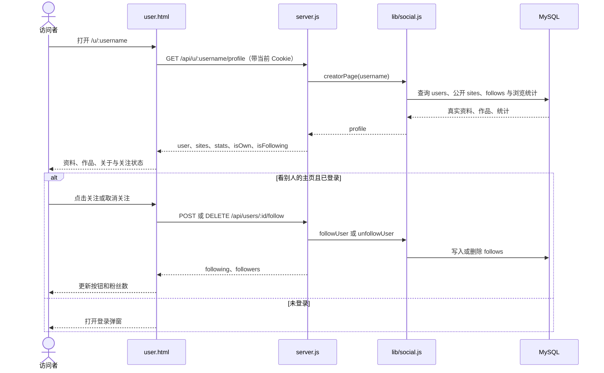

# 创作者主页：资料、作品与关注

## 本轮两条链路

页面目前的 `loadProfile()` 恒返回 `null`，因而真实创作者也被显示成不存在。关注按钮只翻转内存变量，刷新即复原。后端接口和 MySQL 表均已存在，本轮接通这两条链路。

验收：存在的用户显示资料、公开作品和实际文件数；不存在的用户名显示 404 空态，接口故障显示错误；看自己只显示编辑资料；看别人时关注状态来自数据库，点击后刷新仍一致，失败时不改界面。该页的“收藏”和“私信”当前没有可用的页面闭环，本轮移除误导性入口，留待各自链路接通后恢复。

测试在服务器隔离目录运行，数据库固定为 `minepage_smoke`，不修改运行中的生产服务。
