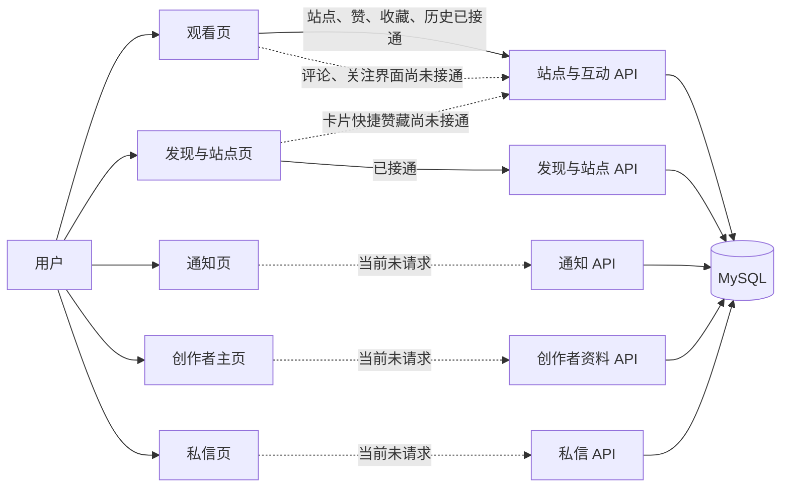
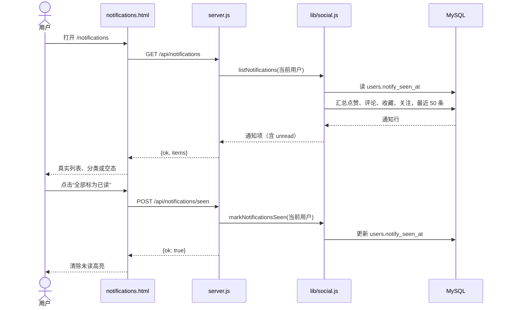

# 从页面到 MySQL：逐条接通

## 改动前链路图

图中的状态以 `main` 的 `8c0c90c` 为基线。「空态」指页面不请求已有接口，页面显示空列表；不代表数据库没有记录。

## 第一条：通知的读取与已读

选择通知作为第一条链路：`likes`、`comments`、`favorites`、`follows` 已有数据层和通知 API，页面却只渲染空数组。范围集中在通知页与通知响应，无须增加表或改动其他页面。

验收边界：未登录访问通知页会跳到登录页，且不能读取或标记通知；读取不改变已读时间；点击按钮成功后刷新仍为已读；接口失败时保留原列表与未读状态。测试只使用服务器的 `minepage_smoke` 库。

## 迭代顺序

1. 创作者主页：资料与作品列表接 `GET /api/u/:username/profile`，关注按钮写入 `follows`；详见 [创作者主页链路图](2026-10-11-creator-profile.md)。
2. 私信：先接会话列表和消息读取，再接发送与已读。
3. 观看页评论：读取、发表、删除各自验收，再处理关注。
4. 卡片快捷赞藏：先补登录用户的互动状态，再让按钮写入数据库。

每一步只改一条用户可见链路，并在服务器独立测试库验证后再进入下一步。
